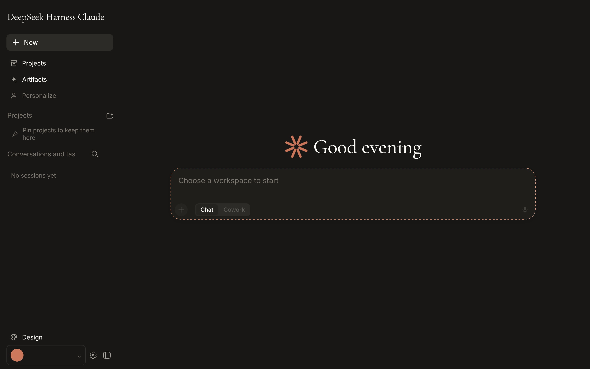
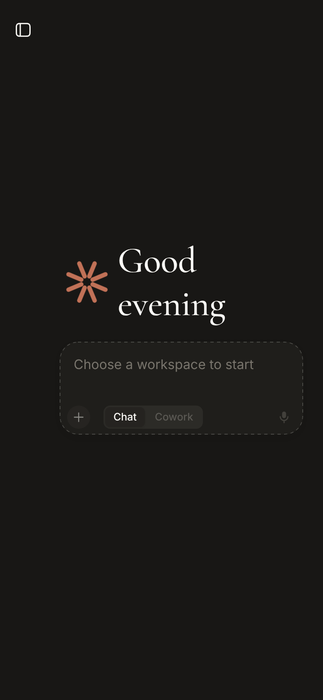
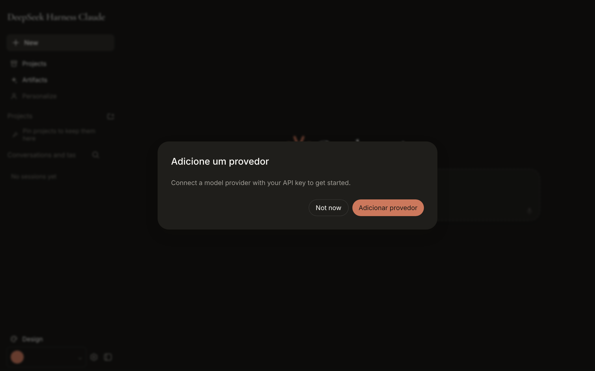
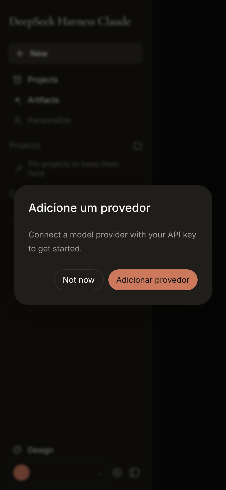

# DSHC: Plano de implementação (o quê, como, por quê)

> **Base:** `BlackYuriJDU/dsh-claude` depois da Onda 0.5 (baseline organizado; cobertura e suíte de navegador pendentes), estudo mestre (`01-estudo-mestre.md`), auditoria (`02-auditoria.md`), plano em ondas (`PLANO.md`) e relatórios `relatorios/onda-0.md` e `relatorios/onda-0.5.md`.
>
> **Para quem:** o dono do projeto (decisões) e o Claude Code (execução, uma onda por sessão).
>
> **Regra:** este plano é subordinado ao `CLAUDE.md` do repositório. Todo item cita onde mexer (arquivo, pacote ou slot) e por que aquele é o lugar certo. Nada aqui foi implementado ainda; só a Onda 0.5 foi executada.

---

## 0. Resumo em uma página

| Onda | Entrega | Por que nesta ordem | Tamanho |
|---|---|---|---|
| **0.5** ✅ | Baseline: typecheck, lint, 37 gates estáticos, build, testes e snapshots sem chave | Sem baseline, nenhuma onda mede nada | feito |
| **0.6** (nova) | CI que roda no fork, bug da Trajectory, dívidas pequenas, **cobertura de 100%** e **suíte de navegador** | O CI do fork nunca executou os jobs principais; cobertura e `test:web` ainda estão vermelhos | 5 PRs |
| **1** | Marca `DSHC` (UI e identidade visível ao modelo) + sandbox `workspace-write` por padrão | Pré-requisito jurídico e de segurança para qualquer distribuição | 2 PRs |
| **2** | Sistema visual próprio, tema claro + escuro, responsivo de verdade, motion | É a "cara" do produto; a preferência declarada é por boa construção visual | 4 PRs |
| **3** | Artifacts duráveis (eventos, projeção, tools, nó, painel lateral) | Maior gap funcional; valida a arquitetura de ponta a ponta | 4 PRs |
| **4** | Citações clicáveis | Metade já existe (`presentationMeta` normalizado) | 2 PRs |
| **5** | Gráficos (ECharts) | Primeiro tipo novo de artifact | 1 PR |
| **6** | Planilhas (Univer) e quadro (Excalidraw) | Dependem do G1 | 2 PRs |
| **7** | Editar mensagem e ramificar; linhagem na sidebar | O fork já ramifica por turno; falta editar | 2 PRs |
| **8** | Tela de conectores (MCP) e Reflect (memória) | Extensões de pacotes existentes | 2 PRs |
| **9** | Publicação open source | Só depois de marca, segurança e CI | 1 PR |

**O que mudou em relação ao estudo mestre, por causa do código real** (detalhes no §1):
- O responsivo **já tem** gaveta abaixo de 1024px (`AppFrame`), mas não tem layout próprio para celular (≤ 600px).
- As citações **já têm** fontes normalizadas no `presentationMeta` do `web_search`; falta o renderer e a convenção `[n]`.
- Os tokens de motion **já existem** (`--ds-transition-duration*`, `--ds-ease-in-out`); falta padronizar e aplicar.
- O raciocínio recolhível e a busca de conversas **já existem**.
- **Bug novo:** o botão "inspecionar" de uma ferramenta leva à visão Trajectory, e não há como voltar ao chat (as abas foram escondidas).
- **CI morto:** os jobs principais pedem runners enterprise do upstream e nunca rodaram no fork.

---

## 1. Estado real confirmado (o que o plano assume)

| Área | Estado | Evidência |
|---|---|---|
| Baseline | ✅ verde depois da Onda 0.5 | `relatorios/onda-0.5.md` |
| CI no GitHub | ❌ os jobs `static`, `coverage` e `snapshots` pedem `dsh-ubuntu-24-04-16core`, que não existe no fork; ficam 24h na fila e são cancelados | `.github/workflows/ci.yml:41-46`; run `41825535638` |
| Responsivo | 🟡 gaveta não modal abaixo de 1024px, com scrim, Escape e foco; sem layout de celular (composer, alvos de toque, teclado virtual) | `ui-layout/src/client/AppFrame.tsx:111-183`; nota `2026-09-17-dshc-compact-navigation` |
| Motion | 🟡 tokens existem; `prefers-reduced-motion` já é tratado em ~20 folhas | `ui-theme/src/styles/*.css` |
| Tema | 🟡 só escuro; o tipo `ThemePreference` aceita só `'dark'` | `ui-theme/src/theme-settings.ts`; commit `5d0e5c76c` |
| Citações | 🟡 `searchMetaFromValue` já grava `sources[]` com `{ url, title, snippet, publishedAt }` | `packages/web/tool-web/src/search.ts:154` |
| Raciocínio | ✅ `ReasoningRow` ("Think" recolhível) | `ui-conversation/src/client/chat/ReasoningRow.tsx` |
| Ramificar | 🟡 branch por turno do assistente e fork da sessão inteira; sem "editar mensagem" | `chat/TurnTailNodeView.tsx:45`, `apply.ts:401` |
| Busca de conversas | ✅ título + conteúdo via Host (`session.search`) | `ui-workspace/src/client/WorkspaceBrowser.tsx` |
| Artifacts | 🟡 modal que lista arquivos produzidos (`ui-handoff`); sem objeto, preview ou versão | `ui-handoff/README.md` |
| Painel lateral | ❌ o layout só declara `sidebar`, `conversation` e `shell.overlay` | `ui-layout/src/client/index.ts:33-74` |
| Visão Trajectory | 🐞 alcançável pelo botão "inspecionar" e sem caminho de volta | `ui-conversation/src/client/skeleton/ConversationSession.tsx` (`hideChrome = true`), `apply.ts:390` |
| Marca | ❌ "DSH Claude" na UI e na identidade do modelo | `relatorios/onda-0.md`, Lista 1 |
| Sandbox | ❌ `danger-full-access` por padrão | `packages/bundle/base/cordis.patch.yml:176` |

---

## 2. Decisões

As quatro decisões do pacote continuam valendo: **D1** React 18, **D2** fork leve, **D3** `workspace-write` por padrão, **D4** marca `DSHC`. O código revelou mais três:

| # | Decisão | Opções | Recomendação |
|---|---|---|---|
| **D5** | Como fazer o CI rodar no fork | (a) trocar o fallback de `runs-on` para `ubuntu-latest`; (b) variáveis de repositório `DSH_CI_LINUX_RUNNER` / `DSH_CI_WINDOWS_RUNNER` com fallback `ubuntu-latest` / `windows-latest`; (c) self-hosted | **(b), aplicada** (patch P1, commit `f7a91e898`). Em repositório público, os runners `ubuntu-latest` são gratuitos. |
| **D6** | Tema | manter só escuro / voltar claro + escuro | **Claro + escuro, com "Sistema" como padrão.** A identidade "warm canvas" é clara por natureza, e o claude.ai oferece os dois. |
| **D7** | Idioma da UI | en com pt pontual (hoje) / pt-BR completo com en de fallback | **pt-BR completo** nos pacotes que o usuário vê; `en` continua como fonte das chaves e fallback (o gate de paridade en/pt já garante isso). |

---

## 3. Direção visual (o "como fica")

### 3.1 Princípios
1. **Calmo e editorial, mas próprio.** Superfície quente, tipografia serifada só em títulos, muito respiro. Nada de logo, glifo ou nome da Anthropic (D4).
2. **Conteúdo primeiro.** A coluna de leitura de 760px continua; painéis (sidebar, artifacts) nunca espremem o texto abaixo de 600px: abaixo disso, sobrepõem.
3. **Um sistema de tokens só.** Tudo vem de `ui-theme` (`--dsw-alias-*`); componentes não escrevem cor literal (`docs/web-styling.md`).
4. **Movimento com propósito.** Entradas de 150–250ms, curva de desaceleração, nada de bounce. `prefers-reduced-motion` zera tudo.
5. **Toque é cidadão de primeira.** Alvos ≥ 44px no celular, foco visível em todo controle.

### 3.2 Paleta própria do DSHC (proposta para aprovar na Onda 2)
A paleta atual (`#cc785c` coral, `#faf9f5` canvas) é a do `DESIGN.md`, que descreve a marca da Anthropic. Proposta: mudar a tonalidade o suficiente para ter identidade própria, mantendo o calor.

| Papel | Claro | Escuro | Contraste verificado (claro, sobre o canvas) |
|---|---|---|---|
| Acento de marca (decorativo, nunca texto) | `#C2643F` terracota | `#E08A64` | 3,82:1 (vale como indicador de UI ≥ 3:1; falha como texto) |
| Ação primária (botão, link) | `#9C4A28` (hover `#843D21`, active `#6E321B`) | `#E08A64` com texto `#1D1B18` | 6,13:1 com texto branco; 5,79:1 como link |
| Acento suave | `#F3E2D8` | `#3A2A22` | só fundo de chip e seleção |
| Canvas | `#FBF8F3` | `#1A1917` | |
| Superfície 1 | `#F4EFE7` | `#22211E` | cards, composer |
| Superfície 2 | `#ECE5D9` | `#2B2925` | hover, sidebar |
| Linha decorativa | `#E3DACD` | `#34312C` | divisórias de 1px |
| Borda de controle | `#7A746A` | `#8A8378` | 4,37:1 (borda de input e checkbox precisa de ≥ 3:1) |
| Texto | `#1D1B18` | `#F2EEE7` | |
| Texto secundário | `#5F5A52` | `#A9A296` | AA nas duas |
| Sucesso / alerta / erro | `#2F6B47` / `#8A5A0F` / `#9E3A31` | `#6FB58A` / `#E0A64B` / `#E27A6F` | o alerta `#B7791F` da primeira versão falhava (3,44:1) e foi trocado por `#8A5A0F` (5,58:1); os status precisam passar sobre as superfícies 1 e 2, não só sobre o canvas |
| Foco | `#245FCC` (outline de 2px + offset de 2px) | `#A7C2E8` | 5,53:1; substitui o anel coral a 15% atual, que dá 1,16:1 e falha WCAG 1.4.11 |

O contraste de cada par real (inclusive hover, selected e status sobre superfícies) vira um teste de tokens no `ui-theme`, para que a regra seja gate, não promessa. A primeira versão desta tabela tinha quatro pares que falhavam; foram encontrados pela análise do PDF Ateliê (§3.7) e recalculados.

### 3.3 Tipografia
- **Corpo:** Inter (já self-hosted, OFL).
- **Títulos e wordmark:** trocar Cormorant Garamond por **Fraunces** (OFL, eixos variáveis), em peso 400. Cormorant e Newsreader são tratadas como substitutas abertas da "Copernicus" da Anthropic; uma serifa com personalidade própria desfaz a imitação.
- **Código:** JetBrains Mono (já presente).
- Escala: 12 / 14 / 16 (corpo do chat) / 18 / 20 / 24 / 30 / 40, com `line-height` emparelhado no tema e `tabular-nums` em números.

### 3.4 Marca
- Wordmark `DSHC` em texto (serifa de título), sem glifo radial. Sugestão de símbolo: uma "garra" de três traços curvos, ou um "o" com corte diagonal, desenhado como SVG próprio em `ui-primitives` (substitui `CoralBurst.tsx`). O símbolo entra no favicon e no manifest.

### 3.5 Referências visuais
- **Estado atual do fork** (screenshots desta sessão, servidor real sem chave de API, tema escuro, 1280px e 390px; o modo `?fixture` não passa do onboarding):

  | Desktop 1280px | Celular 390px |
  |---|---|
  |  |  |
  |  |  |
- **Padrões do claude.ai** (fontes descritivas; sem copiar artes): Artifacts abrem num painel à direita do chat, com alternância Código/Preview ([Digital Citizen](https://www.digitalcitizen.life/what-are-claude-artifacts-and-how-to-enable-ai-powered-artifacts-in-settings/), [guia de artifacts](https://ai-fix-hub-scutmox-7383s-projects.vercel.app/issues/claude-artifacts-guide)); citações numeradas e clicáveis nas respostas com busca ([docs da Anthropic sobre web search](https://docs.claude.com/en/docs/agents-and-tools/tool-use/web-search-tool), [MacRumors](https://www.macrumors.com/2025/03/21/anthropic-claude-gets-web-search/)); a sidebar empurra o conteúdo no desktop em vez de cobri-lo ([issue de referência](https://claudeissues.com/issue/52150-bug-desktop-app-sidebar-overlaps-chat-content-without-left-margin-macos)); seção "Customize" na sidebar ([Beginners in AI](https://beginnersinai.org/claude-new-design-overview/)).
- **Protótipo `app/` do Kimi:** só como referência de disposição (não entra no repositório; ver `02-auditoria.md`, B2).

### 3.6 O que os screenshots do estado atual mostram

| Tela | Achado | Onda que resolve |
|---|---|---|
| `desktop-1280-01-onboarding.png` | Título "Boas-vindas ao DSH Claude" em pt e erro "Could not save your profile" em en; marca "Claude" | 1 (marca), 2.5 (i18n) |
| `desktop-1280-02-inicio.png` | Wordmark "DeepSeek Harness Claude"; "Projects" aparece duas vezes (item de navegação e cabeçalho de seção); rótulo cortado "Conversations and tas…"; saudação "Good evening" com o glifo radial; composer tracejado com "Choose a workspace to start" | 1, 2.1, 2.5 |
| `mobile-390-01-inicio.png` | Saudação quebrando em duas linhas ao lado do glifo; composer no meio da tela, não no rodapé; só um ícone de menu solto no topo | 2.3 |
| `mobile-390-02-gaveta-com-modal.png` | A gaveta abre, mas o modal "Adicione um provedor" volta depois de "Not now" | 0.6.3 |

### 3.7 O que aproveitar do PDF "Ateliê" (design system gerado pelo Kimi)

Análise completa, com checagem dupla, em `docs/dshc/pesquisa/analise-atelie.md`. Resumo:
- **Adotar:** a arquitetura primitivo → semântico → componente, com papéis `bg/fg/border/action/focus/status` mapeados para `--dsw-alias-*` (não os nomes `--bg-*` e `[data-theme]` do PDF); escala de espaço de 4px (0–128); foco em outline de 2px; tipografia 12/14/16/18/20/24/30/40 com serifa de display em peso 400 e `tabular-nums` em números; motion 100/160/240ms (entrada)/180ms (saída), com reduced-motion → 0; matriz de estados por componente; alvo de toque de 44px e input de 16px no celular; regras de dataviz ("não usar só cor"); voz e microcopy pt-BR; lista de anti-padrões.
- **Rejeitar:** os primitivos de cor do PDF, que são a paleta de marca da Anthropic (`#FAF9F5`, `#141413`, `#D97757`, `#A9583E`…); as duas figuras do PDF (artes da Anthropic; não entram no repositório); as fontes proprietárias sugeridas; o perfil "MCP App" (vale para apps dentro do Claude, não para um host); os breakpoints xs/sm do PDF (o plano mantém 600 e 1024).
- **Consequências no plano:** a paleta da §3.2 foi corrigida; a fonte de display fica **Fraunces** (o PDF trata Newsreader como substituta aberta da Copernicus, o que a aproxima da marca de origem); e a regra "Product copy is Chinese" em `packages/client/AGENTS.md` (linhas 111 e 148) vira "pt-BR com fallback en" na Onda 2.5.

**2.5 · Revisão de texto e i18n (passo extra, dentro da Onda 2)**
- Varredura das strings visíveis: tudo que o usuário vê com locale `pt` precisa existir no dicionário `pt` (o gate de paridade já garante que não haja chaves órfãs; falta cobertura). Prioridade: onboarding, modais, sidebar e composer.
- Dedupe "Projects" (navegação × seção) e eliminar o truncamento "Conversations and tas…" (rótulo mais curto ou `text-overflow` com `title`).

---

## 4. As ondas em detalhe

Cada item: **o quê → onde → como → por quê → testes → pronto quando**. Todo PR segue os gates do `CLAUDE.md`: typecheck, lint, testes focados com cobertura 100% por arquivo, snapshot sem chave se mudar algo visível ao modelo ou ao usuário, `doc-sync`, Agent Note se não for trivial e GIF de interface (`record-browser-gif`) se mudar algo visível na GUI.

### Onda 0.6 (nova): CI vivo e dívidas encontradas na Onda 0.5

**0.6.1 · CI que roda no fork (D5)** — ✅ feito (patch P1, `f7a91e898`). Pendências: medir a primeira execução (reduzir `DSH_GATE_CONCURRENCY` para 4 se faltar memória), proteger ou apagar a branch `master` do fork e atualizar os comentários "enterprise pools" do `ci.yml`. Detalhes em `pesquisa/analise-patches-p1-p2-p3.md`.
- **Onde:** `.github/workflows/ci.yml` e `ci-master.yml`, expressões `runs-on`.
- **Como:** trocar o literal `'dsh-ubuntu-24-04-16core'` por `vars.DSH_CI_LINUX_RUNNER || 'ubuntu-latest'` (e o equivalente do Windows por `windows-latest`). Medir a duração do job de cobertura em `ubuntu-latest`. Se passar de 60 minutos, ligar o particionamento que o repositório já tem (`COVERAGE_PARTITIONS_ENV` em `scripts/coverage-partitions.ts`).
- **Por quê:** hoje nenhum PR do fork tem sinal de CI. O `node 22.19` também falhava porque o `build` quebrava, o que a Onda 0.5 corrige.
- **Pronto quando:** um PR mostra "all checks passed".

**0.6.2 · Bug: preso na visão Trajectory** — ✅ feito (`8ca55dc41`: as abas aparecem fora do Chat).
- **Onde:** `ui-conversation/src/client/skeleton/ConversationSession.tsx` (`hideChrome = true`) e `apply.ts:390` (`inspectCall`).
- **Como (recomendado):** mostrar a barra de visões quando a visão ativa não é o chat, ou pôr um botão "Voltar ao chat" na toolbar da Trajectory. Alternativa: esconder o botão "inspecionar" dos tool rows enquanto as abas estiverem ocultas.
- **Por quê:** hoje um clique leva a uma tela sem saída; só trocar de sessão resolve.
- **Testes:** teste de componente (clicar em inspecionar → voltar ao chat) e snapshot de interface.

**0.6.3 · Dívidas pequenas** — ✅ feito em parte (`c570f9289`): `knowledgeFileMaxChars` virou `Config`, o título "Think" foi localizado e o README do `ui-settings-general` passou a documentar o contexto de modelo. Ficam o modal de provedor que volta e o modo `?fixture`.
- `KNOWLEDGE_FILE_MAX_CHARS` vira campo de `Config` do `ui-projects` (regra "No hardcoded tunables").
- O título "Think" do `ReasoningRow` entra no dicionário (en/pt).
- O `ui-settings-general` registra um contexto de prompt (`profile:instructions`), mas está na allowlist como "nothing model-facing": corrigir o README e a allowlist.
- O tipo `ThemePreference` (`'dark'`) não descreve o que o `ThemeRuntime` guarda de fato: `setTheme` aceita ids concretos (`'light'`). Na Onda 0.5 isso apareceu como falso "código morto" no lint; a D6 (Onda 2) corrige o tipo junto com a volta do tema claro.
- O modal "Adicione um provedor" reaparece depois de "Not now": persistir a dispensa (por sessão do navegador ou no `ui-onboarding`).
- O modo `?fixture` não passa do onboarding: o `FixtureApiClient` precisa aceitar a escrita do perfil, para que demos e screenshots funcionem sem Host.

**0.6.4 · Cobertura de 100% nos pacotes do fork** — 🟡 em andamento: `ui-memory`, `ui-projects` e `ui-routines` chegaram a 100%.
- **O quê:** 478 pontos não cobertos em cerca de 30 arquivos que o fork adicionou ou alterou (lista em `relatorios/onda-0.5.md`, nota 3).
- **Como:** um spec por arquivo, no padrão dos vizinhos: `browser-plugin.client.spec.tsx` para os `client/index` (registro, locale e dispose do fiber); specs de componente com `@testing-library/react` para `ProfileRows`, `ChatFontRow`, `RoutinesSection`, `ArtifactsModal` e `SidebarRoot`; testes de store para `profile-store` e `chat-font-store`; testes do scheduler com timers falsos para `ui-routines/src/index.ts`. A lógica que hoje está dentro de componentes (por exemplo, o recorte de avatar do `ProfileRows`) vai para funções puras testáveis.
- **Por quê:** é o único gate do CI ainda vermelho, e ele fica visível assim que a 0.6.1 ligar os runners.
- **Pronto quando:** `pnpm run check:ci:coverage` passa num checkout limpo, como usuário comum.

**0.6.5 · Suíte de navegador (`test:web`) adaptada à interface do fork**
- **O quê:** 78 de 84 arquivos em `apps/web/tests/` falham. Eles esperam a sidebar, as abas Chat/Trajectory e o chrome de sessão do upstream, e o modal de provedor ainda pode cobrir a tela.
- **Como:** (1) no scaffold, semear também a dispensa do modal de provedor (ou não exibi-lo quando o mock de provedor está configurado); (2) atualizar os seletores para a estrutura atual da sidebar (`WorkspaceBrowser`); (3) regravar os snapshots de navegador em modo `record` local, revisando cada diff; (4) remover os testes de comportamentos que o fork tirou de propósito, explicando no PR (regra "Tests describe behavior").
- **Por quê:** o `test:web` é gate obrigatório de PR no Linux; sem ele, nenhuma onda visual (2, 3, 4…) tem evidência de interface.
- **Pronto quando:** `pnpm run test:web` passa; arquivos de snapshot regravados e revisados.

### Onda 1: marca (D4) e segurança (D3)

**1.1 · PR "brand"**
- **Onde:** os arquivos da Lista 1 do `onda-0.md`: `apps/web/index.html`, `apps/web/public/manifest.webmanifest`, `ui-renderer/.../DocumentTitle.tsx`, `ui-primitives/src/BrandWordmark.tsx` (+ o novo símbolo, no lugar de `CoralBurst.tsx`), `ui-sidebar/.../SidebarRoot.tsx:279`, `ui-settings-models/.../locales.ts:90`, `apps/web/public/favicon.svg`, `README.md`/`README.zh.md`, `DESIGN.md` e comentários.
- **Identidade visível ao modelo:** `apps/cli/config/agent-presets/{standard,code,cordis,minimal}/agent.cordis.yml` passam de "You are DSH Claude" para "You are DSHC".
- **Como:** troca direta de strings e assets; reescrever o `DESIGN.md` como sistema próprio (com a paleta da §3.2 marcada como "proposta" até a Onda 2); atualizar o teste `ui-brand-official` (o texto do wordmark).
- **Por quê:** é o maior risco jurídico (J1). A identidade do modelo também conta, porque ele responde "Sou o DSH Claude".
- **Testes:** snapshots de transcrição (a persona é visível ao modelo), e2e de título e GIF da interface.

**1.2 · PR "sandbox-default"**
- **Onde:** `packages/bundle/base/cordis.patch.yml:166-205` e `apps/cli/reference/README.md` (+ zh).
- **Como:** voltar `mode` para `DSH_PERMISSION_MODE ?? 'workspace-write'`; tabela de presets `read-only`, `workspace-write` (padrão) e `danger-full-access` com `approval: ask`. O `RiskConfirmation` do `PermissionSelect` já pede confirmação para o acesso total. O gate de comandos destrutivos (`danger.ts`) continua.
- **Por quê:** S1 (exfiltração sem comando destrutivo).
- **Testes:** `apps/web/tests/permission-policy-context.e2e.ts`, `shipped-composition.e2e.ts`, snapshots de permissão e uma Agent Note que reverte a decisão do `156bc55e8` (nota nova com link, conforme a regra das Agent Notes).

### Onda 2: sistema visual, temas, responsivo e motion (prioridade visual)

**2.1 · Tokens DSHC + tema claro e escuro (D6)**
- **Onde:** `ui-theme/src/styles/claude-design.css` → renomear para `claw-design.css`; `theme-settings.ts` (`THEME_PREFERENCES` volta a `['system', 'light', 'dark']`); `AppearanceRow.tsx` (três cubos); `boot-theme.ts`.
- **Como:** definir a paleta da §3.2 como `--dsw-static-*` e mapear os `--dsw-alias-*` existentes; o tema escuro vira override sob `body[data-ds-dark-theme]`, que o presenter do `ui-layout` já aplica. Adicionar um teste de contraste que lê os tokens e verifica AA.
- **Por quê:** identidade própria (D4) e conforto de leitura.

**2.2 · Tipografia**
- Trocar a fonte de display (Fraunces ou Newsreader, OFL) em `fonts.css` e no script que gera o subset; atualizar `THIRD_PARTY_NOTICES.md`.

**2.3 · Responsivo de celular (≤ 600px)**
- **Onde:** `ui-layout` (`columns.ts`, `AppFrame.tsx/.module.css`) e `ui-conversation` (`InputBar`, `ConversationRoot.module.css`).
- **Como:**
  1. Abaixo de 600px, esconder o trilho de 56px e usar um botão de menu no topo; a gaveta cobre 85% da largura.
  2. Composer fixo no rodapé com `env(safe-area-inset-bottom)` e ajuste ao teclado virtual via `visualViewport` (atualiza `--dsh-keyboard-inset`).
  3. Alvos de toque ≥ 44px (`@media (pointer: coarse)`).
  4. A coluna de leitura passa a `min(760px, 100vw - 32px)`.
- **Por quê:** hoje, em 390px, sobram 334px ao lado de um trilho que não ajuda no toque.
- **Testes:** e2e Playwright em 390×844 e 1280×800 (`apps/web/tests/plan-narrow-viewport.e2e.ts` é o modelo), screenshots de referência e GIF.

**2.4 · Motion**
- Padronizar em `ui-theme`: `--dsw-motion-duration-{fast:100ms, base:160ms, enter:240ms, exit:180ms}` e `--dsw-motion-ease-{out, in-out}`, como aliases dos `--ds-transition-*` existentes para não duplicar.
- Aplicar na entrada de mensagens (fade + 4px), na gaveta e no futuro painel de artifacts. Sem biblioteca nova; `motion` 14 só se o CSS não bastar (decisão registrada).

### Onda 3: Artifacts duráveis (G1)

**Novo slot (decisão pendente do relatório da Onda 0):** `ui-layout` declara `'shell.aside': { kind: 'single'; scope: 'session-maybe' }` como terceiro filho de `root`. O `computeColumns` passa a resolver `{ sidebar, center, aside }`, com o aside fechado = 0. Abaixo de 1024px o aside vira uma folha que sobe de baixo, sobreposta à conversa.

**3.1 · Pacote host `@deepseek-ai/dsh-artifacts` (`packages/artifacts/artifacts`)**
- Eventos `artifact/create` e `artifact/update` no `SessionEventMap` (declaration merging, JSDoc `@mode`), com `{ id: ArtifactId, kind, title, version, content | contentRef }`. `ArtifactId` é `Branded<'ArtifactId'>`.
- Projeção `artifacts` pura, com `event.time` (modelo: `session-stats/src/projection.ts`).
- Tools `artifact_create`, `artifact_update` e `artifact_list` (`defineTool`, render `generic`, `presentationMeta` com `{ id, version, kind, title }`).
- `Config`: `inlineMaxBytes` (acima disso, o conteúdo vai para um arquivo do workspace e o evento leva hash e caminho) e `kinds` habilitados.
- A seção de system prompt explica quando criar um artifact (conteúdo autossuficiente com mais de ~20 linhas, código executável, documento).

**3.2 · Pacote cliente `@deepseek-ai/dsh-client-ui-artifacts`**
- `ConversationNodeDefinition` para o cartão inline (título, tipo, versão, botão "abrir"), no slot `conversation.chat.node`.
- Painel no `shell.aside`: cabeçalho com título, seletor de versão e alternância Código/Preview, mais copiar e baixar.
- Store de UI: o artifact aberto e a largura do painel. O conteúdo vem da projeção, nunca da store (regra de camadas).

**3.3 · Preview**
- Sandpack só com templates de browser (`react`, `vanilla`, `vue`, `static`), carregado por import dinâmico, em iframe de outra origem. Markdown e SVG usam o renderer de markdown que já existe (`ui-primitives/src/markdown`).

**3.4 · Integração com o `ui-handoff`**
- O modal "Artefatos" ganha uma aba para artifacts, além dos arquivos produzidos, ou é substituído pelo painel. Decidir no plano da onda.

**Testes:** replay, reload e `sessions.fork` preservam o artifact; snapshot de transcrição com `artifact_create`; snapshots dos SDKs TypeScript e Python (mudança no `SessionEventMap`); GIF.

### Onda 4: Citações (G2)
- **4.1** Seção de system prompt no `tool-web` com a convenção `[n]`, numerando as fontes na ordem do resultado da busca do turno.
- **4.2** Renderer: no markdown do assistente, `[n]` vira um chip clicável com tooltip (título + domínio + favicon), só se `n` existir nas fontes do turno (lidas do `presentationMeta` dos tool results do turno); senão fica como texto. Um rodapé "Fontes" lista as fontes usadas.
- **Por quê:** paridade com o claude.ai e confiança no resultado.

### Onda 5: Gráficos (G3)
- Artifact `kind: 'chart'` com especificação ECharts validada (subset seguro: sem funções ou formatters em string) e tema ligado aos tokens. ECharts carregado sob demanda (Apache-2.0).

### Onda 6: Planilhas e quadro (G4, G5)
- `sheet`: núcleo do Univer (Apache-2.0, sem o Pro), tool `sheet_apply` com operações de célula e exportação via SheetJS CE.
- `board`: Excalidraw (MIT) + `@excalidraw/mermaid-to-excalidraw`; exportação PNG/SVG. tldraw proibido.
- Auditoria de licenças transitivas no `THIRD_PARTY_NOTICES.md` (o hook de pre-commit já regenera o arquivo).

### Onda 7: Editar e ramificar (G6)
- Botão "editar" na mensagem do usuário: `sessions.fork({ atSeq: seq anterior })` e composer da sessão filha preenchido com o texto original.
- A sidebar mostra a linhagem (ícone de ramo e "ramificado de …") a partir do header da sessão filha. Hoje `tree.ts` não projeta a linhagem.

### Onda 8: Conectores e Reflect (G10, G11)
- **Base pronta (patches do dono, revisados):** P2 (`examples/mcp-connectors`: Playwright, Microsoft 365 e Google Workspace) e P3 (`examples/skills-knowledge-work`: `security-review`, `deep-research` e o catálogo `knowledge-work-plugins`). Os dois entram como PRs separados **com as correções** de `pesquisa/analise-patches-p1-p2-p3.md` §3–§4 (registro no `verify-cordis-config`, par zh, falha alta com variável ausente, `subagent` sem `job_output`, login do ms365 pelo terminal, `dsh` no lugar de `dshc`).
- Tela de conectores no lugar do placeholder "em breve" do `ui-settings-general`: catálogo de servidores MCP, status e credenciais via `credentials`.
- Reflect: uma rotina do `ui-routines` propõe memórias; o usuário aprova no `ui-memory`.

### Onda 9: Publicação
- README `DSHC`, aviso de não afiliação, `SECURITY.md`, roadmap público e `THIRD_PARTY_NOTICES.md` atualizado.

---

## 5. Riscos e como mitigar

| Risco | Mitigação |
|---|---|
| O upstream muda APIs (preview v0.1) | Fork leve (D2); sincronizar cedo e pouco a pouco; manter os gates verdes |
| Cobertura de 100% por arquivo encarece a UI | Tirar a lógica dos componentes (funções puras testáveis) e usar `/* v8 ignore */` só com justificativa |
| Sandpack ou Univer pesam no bundle | Import dinâmico; medir o tamanho do bundle no CI |
| Conteúdo grande no log da sessão | `inlineMaxBytes` + arquivo no workspace com hash |
| Testes dependentes de ambiente (root, IPv6) | Rodar o CI como usuário comum (padrão do GitHub); documentado no `onda-0.5.md` |

---

## 6. Como executar (para o Claude Code)
1. Uma sessão por onda, com o prompt de abertura do `PLANO.md` §3.
2. Explorar → planejar (plan mode) → implementar → verificar → relatar em `relatorios/onda-<N>.md`.
3. Toda mudança visual: screenshot em 390px e 1280px, mais um GIF no PR.
